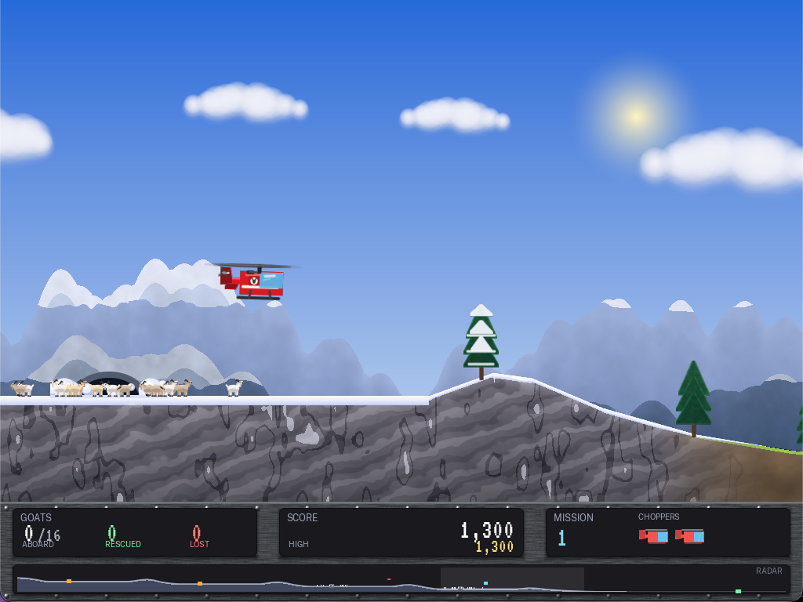

# Menagerie Airlift



A side-scrolling animal-rescue game, a fork of [Choplifter](../choplifter) built with
[Spinel](https://github.com/matz/spinel) and [sdl](https://github.com/jockofcode/sdl). All artwork
and sound is generated procedurally at startup; the only asset file is the app icon, which is
painted by the same code. It was called Capricopter while it was only about goats.

Across twenty-two levels you airlift a whole menagerie home: goats, penguins, puffins, joeys,
sloths, snow leopard cubs, turtle hatchlings, rover pups on Mars and more, by helicopter, by
submarine and by shuttle. On the first level, a blizzard has stranded sixty-four mountain goats on
four ledges of the mountain, each herd huddled in a snow cave sealed shut by a drift. Fly up from
the rescue barn in the valley, blow a drift open with an avalanche charge (or wear it down with
the cannon), set down gently on the ledge so the goats can bound aboard, carry up to sixteen at a
time back down and land on the pad so they can trot into the barn.

The mountain is real terrain, not a backdrop: the chopper can only land on flat ground, any
rock that touches the fuselage is a crash, and crags rise between the ledges, so every sortie
is a climb. Yetis roam the slopes and hurl snowballs at a chopper that comes within reach below
or just above them. Golden eagles sweep across and stoop at anything airborne in one committed
dive, so a quick change of height dodges them. Once you've flown every level, ravens home in on
you. Back over the border fence the valley is safe: birds and ravens break off and head back
to the mountain, none set out after you, and yetis hold their throws. Your cannon rounds fall away with range, so you hit a yeti by hovering at the right height.
Charges only drop when the chopper is turned to face the camera. Goats can be bowled off the
mountain by snowballs, charges and stray rounds, or squashed under your skids, and every goat
aboard is lost in a crash. The mission tally counts every one.

The game gets tougher by laps, not missions: it stays at its easiest until you've flown every
level in the rotation once, and each full lap after that brings more yetis, quicker eagles,
ravens, and faster supply drops ("EVERY LEVEL FLOWN -- LAP 2: TOUGHER FROM HERE"). Every 20,000
points earns a chopper, and the sky fades through alpenglow to a starry night as a mission wears
on. Top-five scores with initials are kept in `~/.menagerie_airlift_scores` (scores from
`~/.capricopter_scores` carry over the first time it runs), and the title screen plays an attract
demo. A chip tune plays between missions (M mutes it); in flight you hear the rotor, and goats
bleat as they climb aboard.

## Requirements

- Spinel (`spin`)
- SDL3, statically linked via the `sdl` package — no `brew install` needed at build or run time

## Install Spinel

With `asdf`:

```bash
asdf plugin add spinel https://github.com/jockofcode/asdf-spinel
asdf install spinel master
asdf set -u spinel master   # make it the default (~/.tool-versions)
```

Or build it from source:

```bash
git clone https://github.com/matz/spinel.git
cd spinel
make
export PATH="$PWD/bin:$PATH"
cd -
```

## Play

```sh
spin run menagerie_airlift
```

Or build first and run the binary directly:

```sh
spin build
./build/bin/menagerie_airlift
```

To make a macOS app bundle (needs the sibling `app_bundler` project built):

```sh
bin/bundle_app.sh      # -> build/Menagerie Airlift.app
```

## Controls

| Key | Action |
|---|---|
| Left / Right or A / D | Thrust (the chopper turns to face the way it flies) |
| Up / Down or W / S | Climb and descend; Up lifts off from the ground |
| Space | Fire the cannon, or drop an avalanche charge while facing the camera |
| X, Z or Shift | Turn to face the camera (for charges), and back again |
| Enter | Start, confirm initials; pause menu during play |
| P | Pause |
| M | Music on / off |
| Tab | Autopilot on / off: the AI flies for you (also Y on a gamepad, or the pause menu) |
| L | Laya's decision panel shown / hidden while the autopilot is on (also the pause menu) |
| R | Back to the title screen |
| Esc | Pause menu: resume, autopilot on / off, panel on / off, or quit |
| Q | Quit immediately |

A gamepad works too (SDL's gamepad support covers Bluetooth Xbox, PlayStation and Switch Pro
pads on macOS): d-pad or left stick flies, A fires or drops a charge, B or X turns, Start starts
the game or opens the pause menu, Back opens it too, Y toggles the autopilot, and hits and crashes rumble.

Land gently and on the level: touching down faster than a slow sink, while still sliding
sideways, or with the skids across a slope wrecks the chopper. Goats only come to a chopper that
has landed on their own ledge, and they hop off only on the pad at the barn.

### Supply drop

After each mission's results comes a bonus round over the home base: twelve crates parachute
down, and you catch them by flying the chopper into them before they smash on the ground. Each
one is worth 300 points, and all twelve earn another 3,000. Nothing attacks you, the cannon and
charges are stowed, and a hard landing just bumps you. Crates fall a little faster and come a
little closer together in each later mission. Each level has its own drop: snow-capped supply
crates by the barn, a **fish drop** of orange cargo cases over the Arctic, a **berry drop** of
huckleberry crates in Cascadia, herring crates in the fjords, crawfish on the bayou, water barrels
in the outback, water jugs in the desert, wool bales under tartan chutes in the Highlands, candy
at Halloween, wrapped gifts at the North Pole, supply pods on retro-rockets on the moon, mangoes
on the volcano, bananas in the jungle, tea chests in the Himalaya, clams under the sea, melons on
the savanna, power cells on Mars, red envelopes at Lunar New Year, chocolates at Valentine's,
pots of gold at St Patrick's, eggs at Easter and picnic baskets on the Fourth of July.

## Levels

There are twenty-two levels: fifteen all year round and seven seasonal ones. On the title screen, Left and Right (or the d-pad) turn a drum of level
names to pick the one the game starts on, and the demo behind the title switches to show it;
missions then cycle on through the others. The rules, scoring and flying are the same everywhere
(every level has the same four ledges, so the demo AI flies them all), but each has its own
ground between the ledges, animals, villain, diving bird, home base, bonus drop and voices, and
the newer ones each have a twist.

| Level | Rescue | Villain throws | Diving bird | Home | Twist |
|---|---|---|---|---|---|
| Mountain | goats in snow caves | yetis, snowballs | golden eagles | the barn | |
| Arctic | penguins in igloos | yetis, snowballs | seagulls | research station | northern lights |
| Cascadia | marmots in hollow stumps | Bigfoot, pinecones | great horned owls | ranger station | |
| Fjords | puffins in turf huts | trolls, boulders | skuas | red fishing cabin | trolls are stone by day and wake angrier at dusk |
| Bayou | ducklings in cypress hollows | the swamp monster, mud | herons | stilt shack | open water: setting down in it sinks the chopper |
| Outback | joeys in caved-in burrows | the bunyip, mud | magpies | station homestead | drop bears let go from the gum trees onto a chopper beneath them (shoot one out of its tree for 200 and it's gone for the mission; the AI does, and never lands under a bear) |
| Desert | tortoises in collapsed burrows | the chupacabra, prickly pears | vultures | adobe ranger post | dust devils shove the chopper about |
| Highlands | lambs in stone bothies | Nessie, river stones | ospreys | whitewashed croft | lochs between the ledges |
| Halloween | black cats in crypts | the werewolf, pumpkins | bats | haunted barn | a violet-and-orange sky |
| North Pole | reindeer in snowed-in stables | Krampus, coal | snowy owls | Santa's workshop | |
| Moon | moon rabbits in habitat domes | Selenites, moon rocks | flying saucers | Moonbase | the chopper is a spaceship: lasers that fly straight (no drop with range), photon torpedoes for charges, alien drones for ravens, and a black sky full of stars with the Earth in it |
| Volcano | iguanas in lava tubes | the fire salamander, magma | frigatebirds | island field station | the ground shakes, then the nearest vent throws lava bombs in high arcs (they wreck the chopper, not the animals) |
| Jungle | sloths in overgrown ruins | the jaguar spirit, coconuts | harpy eagles | field station on stilts | vines over the ruins: the first charge only cuts them, the second opens the ruin |
| Himalaya | snow leopard cubs in snowed-in shrines | the migoi, ice | lammergeiers | the monastery | thin air: the higher the chopper, the weaker it climbs |
| Undersea | turtle hatchlings in sunken wrecks | the kraken, ink | swordfish | Sealab | the chopper is a submarine (torpedoes, depth charges, jellyfish for drones) under water with no sun or stars; currents push it about |
| Savanna | lion cubs in termite mounds | baboons, rocks | marabou storks | safari ranger post | stampedes: a herd thunders along the ground toward the fence, and anything on or near the ground in its path is run down (get up when the ground rumbles) |
| Mars | rover pups in buried habitats | dust wraiths, dust balls | sky mantas | the colony | a spaceship again, and dust storms that blot out everything but the ship (watch the radar) |

**Seasonal levels:**

| Level | In season | Rescue | Villain throws | Diving bird | Twist |
|---|---|---|---|---|---|
| Lunar New Year | a week before to two weeks after the new year | panda cubs in pagodas | the Nian, firecrackers | dragon kites | |
| Valentine's | February 7-14 | lovebirds in candy boxes | Cupid, arrows | swans | Cupid's arrows stun the chopper (no control for a moment) instead of wrecking it |
| St Patrick's | March 10-17 | hedgehogs in fairy forts | the leprechaun, gold coins | rooks | |
| Easter | the week before Easter Sunday, and the Monday | chicks in giant painted eggs | the fox, eggs | hawks | |
| Fourth of July | June 28 to July 5 | puppies in sheds | the raccoon, cherry bombs | nighthawks | a night flight; fireworks go up off the slopes and light the sky (fly into a rocket and it wrecks you) |
| Halloween | October 17 to November 1 | (above) | | | |
| North Pole | December | (above) | | | |

In season, the title screen starts on a seasonal level and missions rotate through it; out of
season you can still pick it on the drum (the note under the drum says when its season is --
"yours just this once"), but missions skip it. `AIRLIFT_SEASON=1` treats them all as in season,
`=0` none.

Startup paints only the first level's art. The rest are painted in the background a few
milliseconds a frame, starting with the levels next to the title screen's pick (or the next
mission's level in a game), so the ones you're likely to need next are ready well before you get there. A level needed
before it's done is finished at once behind a short "FLYING TO THE ..." card.

Action shots of every level are in [`assets/screenshots/action/`](assets/screenshots/action).

## Autopilot

Tab (Y on a gamepad, or AUTOPILOT in the pause menu) hands the stick to the same AI that flies the
title demo, and Tab again takes it back, mid-flight if you like. While it flies, an AUTOPILOT tag
shows at the top right and your stick and buttons are ignored. The setting carries over to the
next game. Laya's decision panel (below) only appears while the autopilot option is on, and L (or PANEL in
the pause menu) hides it while the autopilot keeps flying: beside
the high scores on the title screen, and in the top left while the autopilot flies a game, where
Laya picks its goals as it does for the demo.

## Laya on the title screen

The attract demo is piloted with help from [Laya](../laya), a small on-device decision model.
Every time the demo chopper picks what to do next, Laya chooses between **LAND** (pick up waiting
goats), **BLAST** (charge a snow drift open) and **HOME** (fly back and unload); the scripted AI
then flies that goal, dodging and fighting as usual. The AI tells Laya which goals are possible
and which it would pick itself; a shield swaps an impossible pick for the likeliest possible one.
A panel beside the high scores shows Laya's odds for each goal, the goal being flown, and how
long each call takes.

Laya runs on its own thread and loads in a second or two; until then, or if its weights are
missing, the scripted AI flies the demo alone. Games you fly yourself are never touched. The weights live in
the laya checkout next to this one (`sh ../laya/bin/fetch_model.sh`); `AIRLIFT_LAYA_MODEL=dir`
points elsewhere, `AIRLIFT_LAYA=0` turns Laya off, and `LAYA_BACKEND` picks its backend. The first
`spin build` asks to build laya's native code: answer `always`, or run `spin trust laya` first.

## Layout

| Path | What it is |
|---|---|
| `bin/menagerie_airlift.rb` | Entry point: window, input, frame loop |
| `lib/airlift/config.rb` | Every tunable, plus the mountain: ledges, terrain profile, `ground_y` lookup |
| `lib/airlift/game.rb` | Rules and the fixed-step simulation, screen flow, high scores, demo AI |
| `lib/airlift/canvas.rb` | CPU raster canvas: SDF shapes, shading, noise, text, texture upload |
| `lib/airlift/levels.rb` | The level registry: each level's words, effect colors, terrain profile, water and twist; seasons |
| `lib/airlift/art.rb` | Skies, peaks, clouds, the mountain slices, barn, drifts, chopper, goats, yetis, birds, panel, logo, the Arctic and Cascadia sets, and `LevelArt` (one level's set, painted on demand) |
| `lib/airlift/levels/*_art.rb`, `*_sound.rb` | The other seven levels' art sets and voices |
| `lib/airlift/laya_pilot.rb` | Laya's goal picks for the title demo, on a background thread |
| `lib/airlift/view.rb` | Per-frame drawing, parallax, status panel with the radar profile, overlays |
| `lib/airlift/sound.rb` | Synthesized sound effects (each level's animal and villain voices), rotor drone and chip tune |
| `tools/make_icon.rb` | Paints `assets/icons` with the same rasterizer (run `tools/make_icon.sh`) |

To reshape the mountain, edit `MOUNTAIN_LEDGES` and `MOUNTAIN_PTS` in `config.rb` (the other
levels' profiles are in `levels.rb`; all share the ledges). The ledges are the flat stretches of
the profile; the art, collisions, goats, yetis and AI all read the same heightfield.

## Development

Headless soak test — the demo AI flies sorties for twelve simulated minutes while the test
checks that nothing goes non-finite, the chopper stays above the ground and inside the world,
every goat is always accounted for and some actually get rescued. `TRACE=1` prints each crash
with the AI's state, `SEED=n` flies a different (still repeatable) run, and `MISSION=n`
starts on mission `n`, and `LEVEL=n` starts the game on level `n` (numbered as in
`lib/airlift/levels.rb`: 0 mountain, 1 Arctic, 2 Cascadia, 3 fjords, 4 bayou, 5 outback, 6 desert,
7 Highlands, 8 Halloween, 9 North Pole, 10 moon, 11 volcano, 12 jungle, 13 Himalaya, 14 undersea,
15 savanna, 16 Mars, 17 Lunar New Year, 18 Valentine's, 19 St Patrick's, 20 Easter, 21 Fourth of
July). It also counts the twists as they fire (drop bears letting go or shot out of their trees,
dust devils and currents, trolls waking, splashdowns, tremors and eruptions, vines cut,
stampedes, dust storms, fireworks, stuns):

```sh
spinel test/sim.rb -o build/sim && ./build/sim
```

Debug environment variables for the game binary:

| Variable | Effect |
|---|---|
| `AIRLIFT_AUTOPLAY=1` | The demo AI flies a real game |
| `AIRLIFT_LAYA=0` | No Laya: the scripted AI flies the title demo alone |
| `AIRLIFT_AUTOPILOT=1` | Start with the autopilot option on |
| `AIRLIFT_PANEL=0` | Start with Laya's panel hidden |
| `AIRLIFT_LAYA_MODEL=dir` | Laya weights directory (default `../laya/models/laya-multilingual`) |
| `AIRLIFT_SHOT=/path.png` | Save frame `AIRLIFT_SHOT_FRAME` (default 240), read back from the renderer, then quit |
| `AIRLIFT_MISSION=n` | Start a game on mission `n` (missions cycle through the levels) |
| `AIRLIFT_LEVEL=n` | Pick level `n` (as for `LEVEL` above) on the title screen |
| `AIRLIFT_SEASON=1` or `=0` | Treat the seasonal levels as in season, or out |
| `AIRLIFT_MUTE=1` or `=0` | Mute every sound and the music (screenshot runs with `AIRLIFT_SHOT` are muted unless `=0`) |
| `AIRLIFT_SCREEN=results\|bonus\|dead\|game_over\|entry` | Jump straight to that screen |

The SDL log is written to `/tmp/sdl_menagerie_airlift.log`, including how long each piece of art took
to generate.
